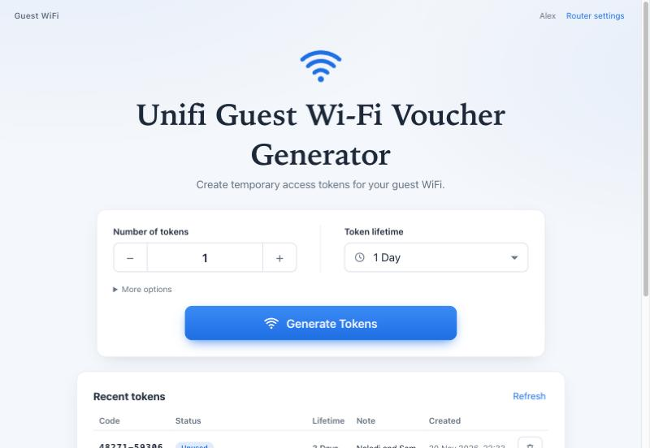
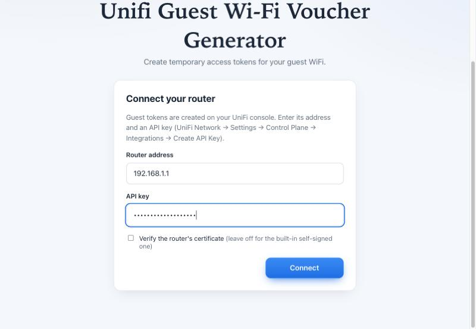
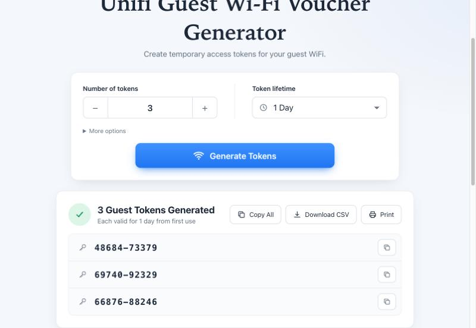
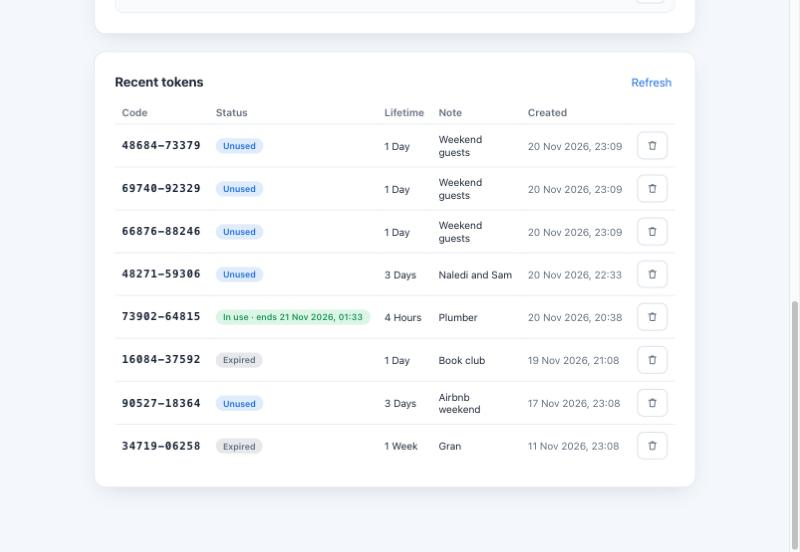
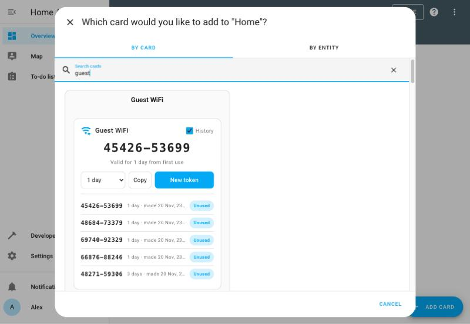
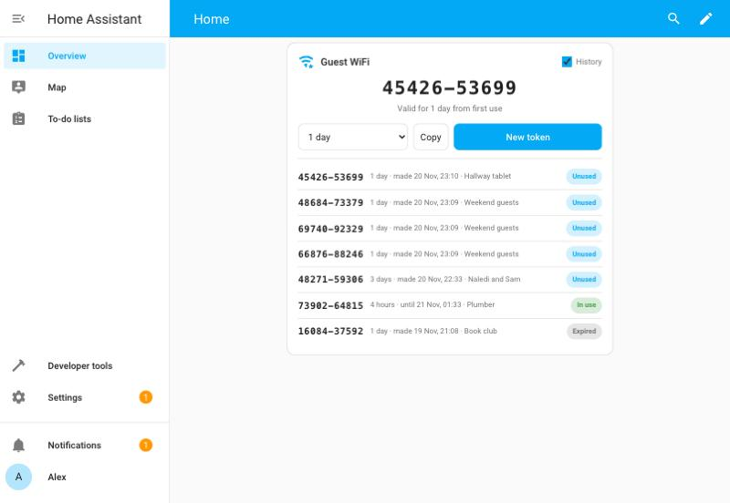

# Unifi Guest Wi-Fi Voucher Generator: Home Assistant add-on

Generate guest Wi-Fi tokens (UniFi hotspot vouchers) from Home Assistant: from the sidebar,
from a dashboard card, or from an automation.



- Pick how many tokens and how long each lasts (1 hour to 30 days, counted from the guest's
  first login), optionally how many devices per token and a note.
- Copy one or all codes, download a CSV, or print cut-out cards for guests.
- See recent tokens (unused / in use / expired) and revoke any of them.
- **Dashboard card**: shows the latest token, makes a new one with one tap, and can list a
  history of tokens with their status.
- **Automations**: a script blueprint creates tokens and returns the code to your
  automation (send it in a notification, show it on a display, ...).

The screenshots on this page use sample data.

## What you need

- Home Assistant with add-on support (Home Assistant OS or Supervised).
- A UniFi console with the Network integration API (UniFi Network 9 or later) that Home
  Assistant can reach on your network.
- A guest network that uses the hotspot portal with **vouchers** as the sign-in method.

## Setup

### 1. Add this repository to Home Assistant

[](https://my.home-assistant.io/redirect/supervisor_add_addon_repository/?repository_url=https%3A%2F%2Fgithub.com%2Fimne%2Funifi-guest-wifi-ha-addon)

Click the button, or do it by hand: Settings → Add-ons → Add-on Store → ⋮ (top right) →
**Repositories**, and add:

```
https://github.com/imne/unifi-guest-wifi-ha-addon
```

### 2. Install and start the add-on

1. In the Add-on Store, find **Unifi Guest Wi-Fi Voucher Generator** (reload the page if it
   is not listed yet) and click **Install**. Home Assistant builds the add-on on your
   machine, which can take a few minutes.
2. Click **Start**.
3. Turn on **Show in sidebar**. A **Guest WiFi** entry appears in the sidebar.

### 3. Create an API key in UniFi

In UniFi Network, go to Settings → Control Plane → Integrations and choose
**Create API Key**. Copy the key and keep it somewhere safe.

### 4. Connect the add-on to your router

Open **Guest WiFi** in the sidebar. The first time, it asks for your router's address and
the API key, checks them against the router, and remembers them.



Leave **Verify the router's certificate** off if your console uses its built-in
self-signed certificate, which most do.

You can also set these on the add-on's **Configuration** tab instead (router address, API
key, certificate check). Values set there win over the ones entered in the app, and the
add-on has to be restarted to pick them up.

### 5. Generate your first tokens

Choose the number of tokens and their lifetime, then press **Generate Tokens**. Copy the
codes, download them as a CSV, or print them as cut-out cards.



**Recent tokens** shows what you have made, whether each token is unused, in use or
expired, and lets you revoke one with the bin icon.



### 6. Add the dashboard card (optional)

The add-on installs a **Guest WiFi** card for your dashboards. Check the add-on's **Log**
tab: it says "dashboard card installed". If the log also asks for it, restart Home
Assistant once.

Then edit a dashboard, choose **Add card** and search for "guest":



The card shows the latest token with a Copy button and makes a new one with one tap. The
**History** switch on the card turns the list of recent tokens on or off.



Every Home Assistant user can use the card and the **Guest WiFi** sidebar entry. Only
administrators can connect or change the router. To limit everything to administrators,
turn on **Administrators only** on the add-on's Configuration tab.

### 7. Use it in automations (optional)

1. Go to Settings → Automations & scenes → Blueprints → **Import blueprint** and paste:

   ```
   https://github.com/imne/unifi-guest-wifi-ha-addon/blob/main/blueprints/script/guest_wifi_generate_token.yaml
   ```

2. Create a script from the blueprint, for example `script.guest_wifi_generate_token`.
3. Call it from an automation and use the code it returns:

   ```yaml
   actions:
     - action: script.guest_wifi_generate_token
       data:
         lifetime_minutes: 1440
         note: Front door
       response_variable: wifi
     - action: notify.mobile_app_my_phone
       data:
         message: "Guest Wi-Fi code: {{ wifi.code }}"
   ```

`wifi.code` is the first token, `wifi.codes` all of them, and `wifi.error` says what went
wrong. The add-on also creates a ready-made `script.guest_wifi_generate_token` that works
the same way, so the blueprint is only needed if you want your own variant.

More detail on every option is on the add-on's **Documentation** tab
([guest_wifi/DOCS.md](guest_wifi/DOCS.md)). What changed in each version is in the
[changelog](guest_wifi/CHANGELOG.md) and under
[Releases](https://github.com/imne/unifi-guest-wifi-ha-addon/releases).

## Troubleshooting

- **"Could not reach a router at ..."**: Home Assistant cannot open the address on port 443.
  Check the address and that the two are on networks that can talk to each other.
- **"The router did not accept that API key"**: create a new key in UniFi and enter it again.
- **The certificate could not be verified**: turn off "Verify the router's certificate".
- **The card is not in the card picker**: reload the browser page; if the add-on's log
  asked for a Home Assistant restart, do that first.
- **Installing without GitHub**: copy the `guest_wifi` folder to `/addons/guest_wifi` on the
  Home Assistant machine (Samba or SSH add-on), then Add-on Store → ⋮ → Check for updates.
  It appears under "Local add-ons".

## For developers

### How it works

```
browser ──► Home Assistant (login, ingress proxy)
              └─► add-on :8099 ──► UniFi Network API on your router
```

- `guest_wifi/server.js`: Node 22, no dependencies. Only Home Assistant's ingress proxy may
  connect; it supplies the signed-in user. Writes need a custom header (CSRF protection).
- `guest_wifi/automations.js`: listens for the `guest_wifi_generate` event, publishes
  `sensor.guest_wifi_last_token`, installs the dashboard card (`guest_wifi/card/`).
- `blueprints/script/`: script blueprint that returns the code to an automation.
- `guest_wifi/public/`: the UI (plain HTML/CSS/JS, light and dark mode).
- The router's address and API key come from the add-on's options (`/data/options.json`),
  or from the in-app setup (`/data/settings.json`) when the options are empty.
- Every Home Assistant user sees the panel; the add-on asks Home Assistant who is an
  administrator and lets only them change the router connection. The option `admins_only`
  limits the whole add-on to administrators.

### Test without Home Assistant

```bash
OPTIONS_FILE=/tmp/guest-wifi-options.json SETTINGS_FILE=/tmp/guest-wifi-settings.json ALLOWED_CLIENT_IPS=127.0.0.1 HOST=127.0.0.1 node guest_wifi/server.js
```

```bash
node dev/ha-ingress-sim.js
```

Then open http://127.0.0.1:8123: a stand-in for Home Assistant's ingress proxy (frame,
path prefix, user headers).

### Release

Every version gets release notes, so people see what changed when Home Assistant offers the
update.

1. Bump `version` in `guest_wifi/config.yaml` and `guest_wifi/package.json`.
2. Add a section for it at the top of `guest_wifi/CHANGELOG.md`: what is new or fixed, in
   plain words, plus anything to do after updating ("After updating: ...") and any new
   permission or behaviour to know about ("Good to know: ...").
3. Run `dev/check-release.sh`; it fails if the versions differ or the notes are missing.
4. Push. Home Assistant offers the update and shows the notes.
5. Tag the commit and publish a GitHub release with the same notes, so every version is
   listed under Releases:

   ```bash
   git tag -a v1.3.3 -m "Unifi Guest Wi-Fi Voucher Generator 1.3.3" && git push origin v1.3.3
   ```

   Then GitHub → Releases → Draft a new release: pick the tag, use the version as the
   title, and paste the output of `dev/release-notes.sh 1.3.3` as the description.
