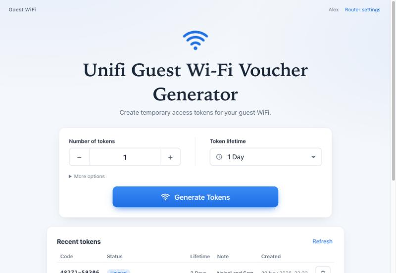
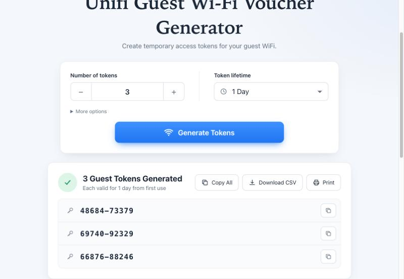
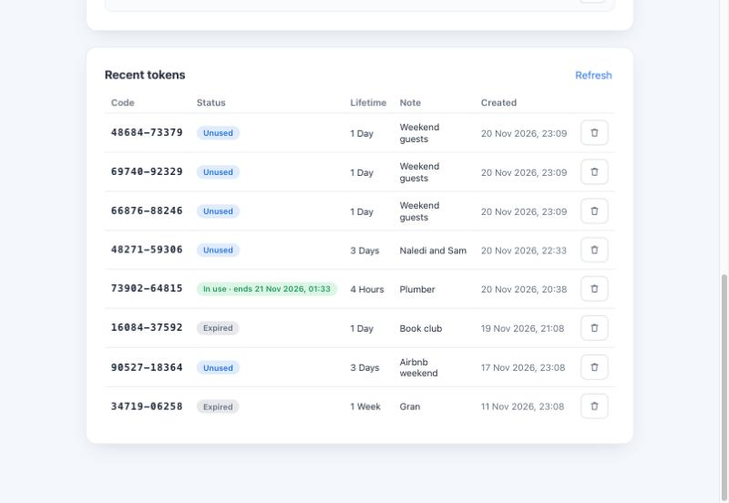
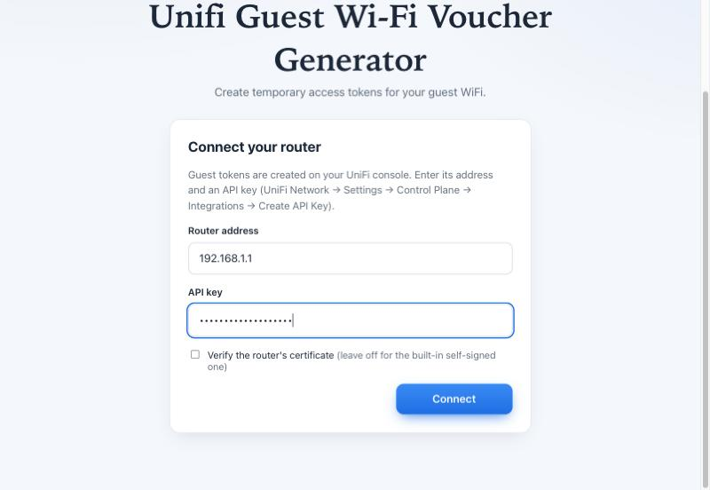
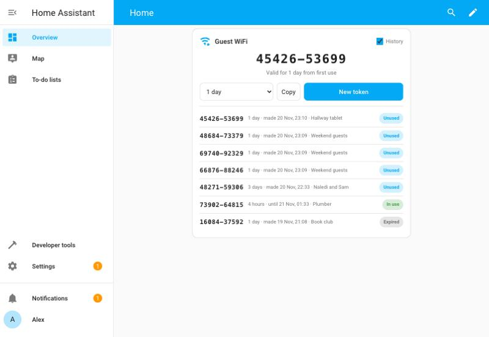
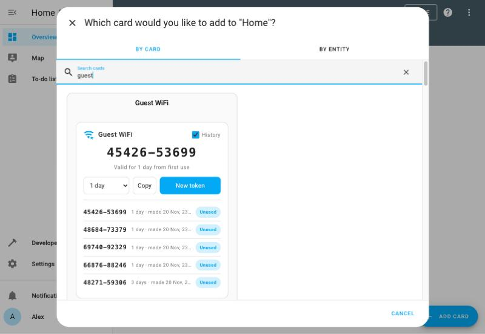

# Guest Wi-Fi vouchers from Home Assistant, in one tap

Every time someone visits, the same thing happens. They ask for the Wi-Fi, and I either
read out a long password or open the UniFi console, dig through Hotspot settings, create a
voucher, and copy the code across. It works, but it's five minutes of clicking for
something I do every week.

So I built a Home Assistant add-on for it: **Unifi Guest Wi-Fi Voucher Generator**. It
creates UniFi hotspot vouchers from the Home Assistant sidebar, from a dashboard card, or
from an automation. It's free and open source:
[github.com/imne/unifi-guest-wifi-ha-addon](https://github.com/imne/unifi-guest-wifi-ha-addon).



## What it does

You pick how many tokens you want and how long each should last, from one hour to thirty
days. Press **Generate Tokens** and the codes appear, ready to copy, download as a CSV, or
print as cut-out cards for the fridge.



A token's lifetime starts when the guest first logs in, not when you create it. You can
make a handful on Monday for a weekend visit and none of them burn down early.

Below the generator is a list of recent tokens. Each one shows whether it is still
unused, in use (and until when), or expired, along with the note you gave it. The bin
icon revokes a token, which is handy when the plumber has left.



## Setting it up

The add-on talks to your UniFi console through its official API, so it needs two things:
the console's address and an API key. You create the key in UniFi Network under
Settings → Control Plane → Integrations.

You can enter both on the add-on's Configuration tab. Or leave them empty, and the app
asks for them the first time you open it. Either way it tests the connection before saving
and tells you plainly what's wrong: unreachable address, rejected key, or a certificate
problem.



The key stays on your Home Assistant machine. The app never shows it again and never sends
it to the browser.

## A card for your dashboard

The add-on also installs a **Guest WiFi** dashboard card. It shows the latest token in
large type with a Copy button, and makes a new one with a single tap. It suits a wall
tablet in the hallway.



The card can list a short history of recent tokens with the same status badges. A
**History** switch on the card turns that list on or off, and each device remembers its
own choice, so a wall tablet can stay minimal while your phone shows everything.



## Tokens from automations

The repository also includes a script blueprint that creates a
token and hands the code back to whatever called it. That means an automation can make a
token and do something with it in the next step:

```yaml
actions:
  - action: script.guest_wifi_generate_token
    data:
      lifetime_minutes: 1440
      note: Front door
    response_variable: wifi
  - action: notify.mobile_app_my_phone
    data:
      message: "Guest Wi-Fi code: {{ wifi.code }}"
```

Some things you could build on that:

- Send a fresh code to your phone when you switch on a "guests" toggle.
- Put a new code on an e-ink display every morning.
- Message a code to your Airbnb guest on check-in day.

If something goes wrong, `wifi.error` says what, so the automation can tell you instead of
failing silently. As a safety net, automations can create at most 60 tokens an hour.

## Installing it

1. In Home Assistant, go to Settings → Add-ons → Add-on Store → ⋮ → **Repositories** and
   add `https://github.com/imne/unifi-guest-wifi-ha-addon`.
2. Install **Unifi Guest Wi-Fi Voucher Generator** and start it.
3. Turn on **Show in sidebar**, open **Guest WiFi**, and connect your router.

It needs a UniFi console with the Network integration API (UniFi Network 9 or later) and a
guest network that uses the hotspot portal with vouchers.

## Good to know

- Every Home Assistant user can generate tokens, from the sidebar page and the dashboard
  card. Only administrators can connect or change the router, and an option limits the
  whole thing to administrators if you prefer.
- Token codes are stored in two Home Assistant sensors so the card and automations can read
  them. Anyone who can see entities in your Home Assistant can see the codes.
- The add-on only lists and revokes tokens it created itself. Vouchers you made in the
  UniFi console are left alone.

Every release comes with notes on what changed, both in Home Assistant's update dialog and
on the [releases page](https://github.com/imne/unifi-guest-wifi-ha-addon/releases). If you
try it and something doesn't work, open an issue on GitHub.
